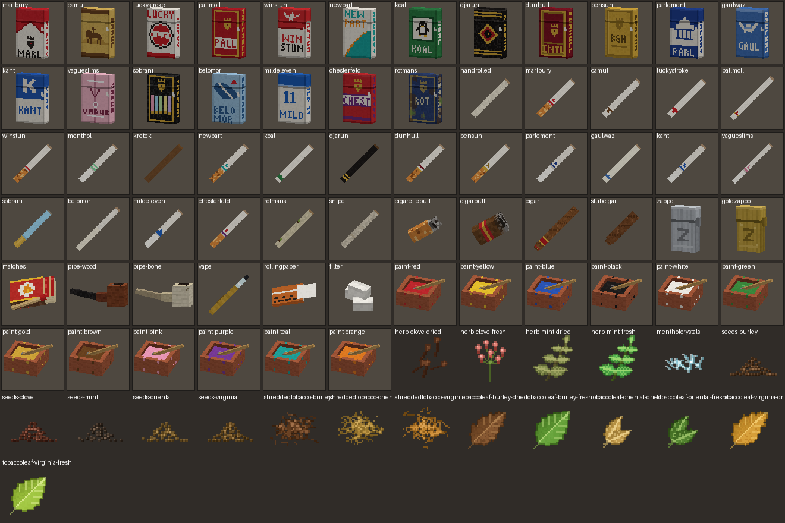
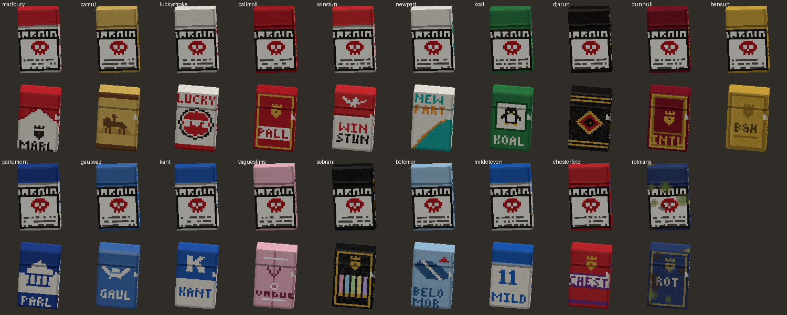
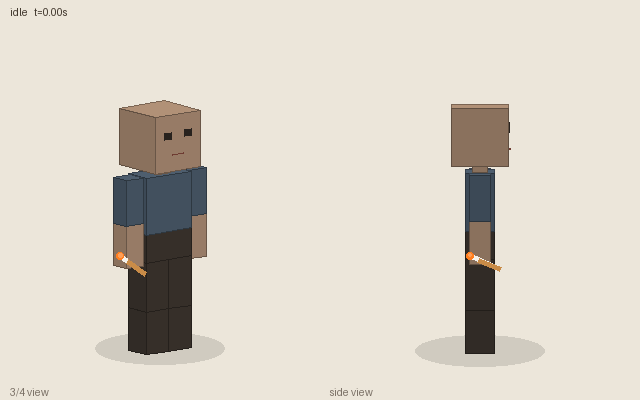
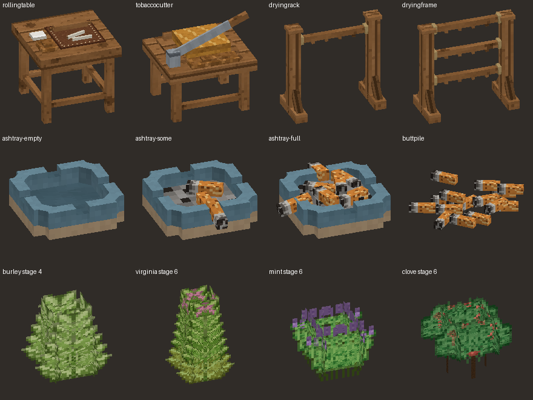

# Cigarettes (Vintage Story mod)

The whole smoking culture for Vintage Story 1.22. You can grow tobacco, cure and shred it, and roll cigarettes by hand or in batches. There are also cigars, pipes and a temporal-gear vape, and nineteen parody brands in dyed packs, one of which rots. A 71-achievement Smoker's Ledger hands out character traits. When you're done, flick the butt onto the ground and watch the pile grow. Every item description doubles as a health warning.



**Status: v0.8, compiles clean against Vintage Story 1.22.7 (.NET 10); first in-game load test pending.** All JSON parses, and every texture, shape, drop, recipe ingredient and lang key resolves.

The full design, with every number, is in [DESIGN.md](DESIGN.md). The same material, written for players, is in the in-game handbook (Guides tab).

## Features

### Tobacco and herbs
- There are three tobacco varieties (Virginia, Burley, Oriental), each with its own nutrient, climate range, seeds, crop, leaves and shredded tobacco. The last two growth stages stand 1.5 blocks tall.
- Mint (which becomes menthol crystals) and clove shrubs grow on the same crop block.
- Fresh leaves dry in 96 h, or 6× faster on a **drying rack** (4 leaves) or **drying frame** (12 leaves). A knife shreds a dried leaf into 2 shredded tobacco.

### Batch furniture
For each piece, right click with ingredients to load it, hold right click with an empty hand to work it, and sneak + right click with an empty hand to unload it.
- **Tobacco cutter:** shreds up to 32 dried leaves of one variety in one crank.
- **Rolling table:** rolls up to 8 pairs at 24 cigarettes per paper, where hand rolling gives 20. Add menthol crystals for menthols or cloves for kreteks.

### Smokables
- Hand-rolled cigarettes, menthols and kreteks (which crackle and spit embers), cigars, stub cigars, and snipes rolled from 6 old butts.
- Wooden and bone pipes, packed with shredded tobacco from the offhand.
- The **Jool temporal vaporizer**. It runs on e-liquid (a real liquid, brewed in a barrel, in plain, menthol or clove), clicked in as a cartridge (half a glass slab + 0.8 L of e-liquid make 4) or filled straight from a placed bucket, jug or barrel, and is charged with a temporal gear (300 puffs) or a rusty gear (40 puffs).
- Light from the offhand with a torch, lantern, matches, a Zappo lighter, or another lit cigarette (chain smoking). In the main hand, matches and lighters light firepits, torches and anything else a firestarter can, instantly.

### Brands and packs
- There are 19 parody brands (Marlbury, Camul, Lucky Stroke, Pall Moll, Djarun Black, Belomorkanaal, Rotmans…), each with its own blend, strength, slogan and one of 12 Seraph General's Warnings.
- Packs are coloured with the game's own **dye**: put wooden buckets of dye in the brand colours into the pack recipe (0.1 L per colour). The 11 filtered brands use 10 cigarette butts as the filter.
- Right click a pack to shake one out. Empty packs stay, and right clicking with cigarettes in the offhand fills a pack back up with any kind. Packs and cigarettes show their tobacco blend.
- **Blank packs** (2 parchment make 2) can be dyed into any brand's empty pack with the same dye buckets, then filled.
- **Rotmans** is made from rot and comes in a rotting pack that perishes in your inventory.



### Butts and ashtrays
- Every smoke leaves a butt. Butts can also be crafted, and they are ingredients in the filtered pack recipes.
- **Flick** a butt: hold right click to aim (with the throwing reticle), release to flick. It tumbles through a figure eight and lands as ground storage, in a pile that grows up to 64 butts per block. If it lands in an ashtray it goes in, which unlocks the secret Hole in One.
- The ashtray holds 12 butts, shows empty, some or full, and spills when broken.

### Placing things
- Sneak + right click puts any of the loose items (cigarettes, packs, lighters, pipes, leaves, herbs...) down as ground storage.

### Effects
- Each puff gives a 10-minute buff (less hunger, faster mining) scaled by strength.
- Nicotine builds up and decays. Above 30 with no buff you get a mild withdrawal (a little hungrier, a little slower, plus craving lines). Above 50 you cough in chat.

### The Smoker's Ledger
- It has 71 achievements in 7 categories, 4 tiers worth 1,335 points in total, and 8 ranks. Every rank-up is announced to the whole server, and some ranks come with rewards (papers, a Golden Zappo, cigars).
- There are prerequisite chains, 11 hidden achievements, situational ones (smoking in a storm, on fire, at 2 HP, next to a trader…), streaks, and collections.
- 13 achievements grant permanent character traits, such as Smoker's Lungs, Deadeye and Platinum Lung.
- `/smokestats` shows your summary, `/smokestats list [category]` shows every achievement with its progress, and `/smokestats ranks` lists the ranks.

### Presentation
- **Animations:** a hand-to-lips drag (`cigarettes-smoke`, with a first-person variant) and an exhale when a puff completes. They replace the vanilla eat animation.
- **Art:** original textures for every item, block and pack. Packs, cigarettes (long and slim variants), butts, cigars, pipes, the vape, lighters, matches, papers and filters have 3D models, the furniture has real shapes, and the mod has an icon.
- **Handbook:** 11 guide pages covering tobacco, curing, rolling, smoking, pipes, butts, brands, pack dyes, vaping and the Ledger, cross-linked to the items.





## Layout

Follows the official `dotnet new vsmod` template (VintageStory.Mod.Templates 1.22.0).

```
Cigarettes.sln
build.sh / build.ps1          packages Releases/cigarettes_<version>.zip via CakeBuild
CakeBuild/                    build + JSON validation + packaging
Cigarettes/
  modinfo.json, modicon.png
  CigarettesModSystem.cs      registers item, block, block entity and entity classes
  Items/                      ItemSmokable (shared smoking), ItemCigarette, ItemPipe, ItemVape,
                              ItemCigarettePack, ItemButt (flicking)
  Entities/EntityFlickedButt.cs   a flicked butt that lands as ground storage or in an ashtray
  Blocks/                     drying rack/frame, ashtray, batch furniture (cutter, rolling table)
  Smoking/SmokingSystem.cs    buffs, nicotine, withdrawal, coughing (server)
  Smoking/AchievementSystem.cs    the Smoker's Ledger and /smokestats (server)
  assets/cigarettes/
    itemtypes/, blocktypes/, entities/, shapes/, textures/
    recipes/grid/, recipes/barrel/
    config/achievements.json  every achievement, tier, rank and reward (data-driven)
    config/handbook/          the 11 guide pages
    config/traits.json        13 traits merged into the game's trait list
    patches/smoking-animations.json   smoke/exhale animations on the player shape
    lang/en.json              all text, jokes included
docs/                         preview renders used in this README
```

Most tuning lives in JSON attributes on the items: `effects`, `strength`, `maxPuffs` and `effectDurationSec`. The withdrawal numbers are at the top of `Smoking/SmokingSystem.cs`.

## Building

1. Install the .NET 10 SDK and Vintage Story 1.22.
2. Set `VINTAGE_STORY` to the game folder (for example `%AppData%\Vintagestory` on Windows, or `%AppData%\VSLGameVersions\<version>` when the game is installed through VS Launcher or `~/ApplicationData/vintagestory` on Linux).
3. Run `dotnet build Cigarettes/Cigarettes.csproj` to compile, or `./build.sh` (`./build.ps1` on Windows) to produce `Releases/cigarettes_0.8.0.zip`.
4. Run the "Client" launch profile to start the game with the mod loaded from source.

## First build checklist

Nothing has been run in the game yet. These are the places most likely to need a fix, roughly in order:

**Compile**
- Ground storage: `BlockEntityGroundStorage.ForceStorageProps` and `StorageProps` in `EntityFlickedButt.PutInto`.
- Traits: reflection on `CharacterSystem.applyTraitAttributes` in `AchievementSystem.GrantTrait`.
- Storm context: `SystemTemporalStability.StormData` in `AchievementSystem`.
- Rotting pack: the `OnTransitionNow` override signature in `ItemCigarettePack`.

**Log on load**
- There should be no `patch ... file not found` for `smoking-animations.json`. If one appears, the player shape (`game:shapes/entity/humanoid/seraph-faceless.json`) or the player entity (`game:entities/humanoid/player.json`) moved, and the patch paths need updating.
- Handbook pages should appear under Guides, and their links should open the right items.

**In game**
- *Hand positions:* items use the default hand transforms. Tune them with `.tfedit` and paste the result into the item as `tpHandTransform` / `fpHandTransform`.
- *Arm pose:* if the hand stops short of the lips or clips into the face, adjust the `MOUTH` pose (`UpperArmR` / `LowerArmR` rotations). The pose generator lives with the animation sources, outside this repo.
- *Packs in the inventory:* if a pack shows its warning side instead of the front, the GUI pose needs a 180° turn.
- *Tall tobacco:* check that stages 5 and 6 don't clip or light oddly at the top.
- *Butt piles:* flick a few onto the same spot. They should stack into one pile up to 64, and cigar butts should start their own pile.

## Roadmap

- A cigarette case, fruit-flavoured e-liquid, flue-curing near heat, cigarettes that burn down on their own, smoking idle while walking, and lighting and exhale sounds.
- Wild tobacco in worldgen, and seeds and packs at traders and in ruin loot (still an open question).

## Credits

Benata. Design, code, art, animations and handbook were drafted with Claude Code.
